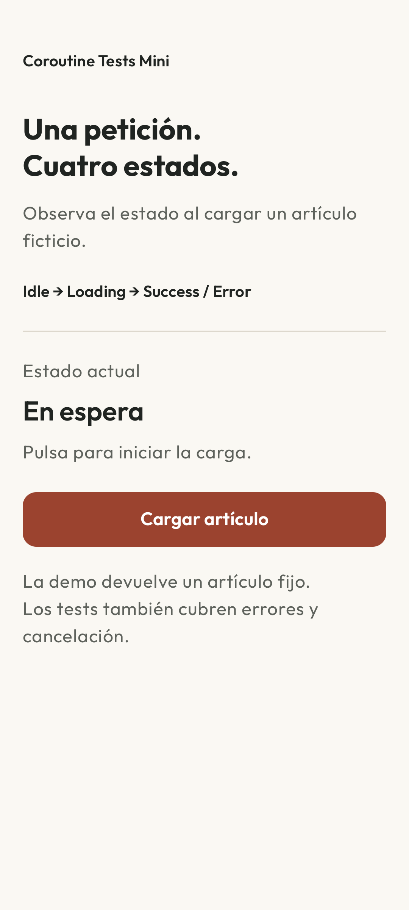

[English](README.md) · **Español** · [](https://github.com/navalcode/android-coroutines-tests-mini/actions/workflows/checks.yml)

# android-coroutines-tests-mini

Proyecto Android pequeño para ver cómo testear coroutines y `StateFlow` en local, sin meter más piezas de las necesarias.

La app permite solicitar un artículo fijo y observar `Idle`, `Loading` y `Success`. El contrato incluye `Error`, ejercitado con un fake en los tests. El ejemplo conecta una pantalla pequeña con pruebas de estado, tiempo virtual y cancelación.

## Usar la pantalla



Una pantalla desplazable separa estado, resultado y acción principal. La respuesta de carga es inmediata y **el botón queda deshabilitado hasta terminar esa petición**. Éxito ofrece Volver a cargar; la recreación conserva el resultado del ViewModel. Los cambios de estado usan una región accesible de anuncio cortés. Hay recursos españoles con fallback inglés; el artículo fijo original conserva su inglés.

La app instalada devuelve siempre ese artículo estático tras un breve retardo. Los tests JVM ejercitan errores, cancelación y sustitución de búsquedas obsoletas, sin simular una red ni añadir controles a la pantalla. Ver [decisiones de pantalla](DESIGN.md) y [avisos de terceros](THIRD_PARTY.md).

## Qué hay dentro

- Una `Activity` mínima para que el proyecto sea Android de verdad
- Un `ViewModel` con `StateFlow<ArticleUiState>`
- Un `UseCase`
- Un `Repository`
- Una implementación estática para la app
- Una fake para tests
- Varios tests locales sobre coroutines, `Flow` y cancelación

## Estructura

```text
app/src/main/java/com/example/coroutinetests/
├── MainActivity.kt
├── data/
│   ├── ArticleRepository.kt
│   └── StaticArticleRepository.kt
├── domain/
│   ├── Article.kt
│   └── LoadArticleUseCase.kt
└── presentation/
    ├── ArticleUiState.kt
    └── ArticleViewModel.kt

app/src/test/java/com/example/coroutinetests/
├── domain/LoadArticleUseCaseTest.kt
├── presentation/ArticleViewModelTest.kt
├── rules/MainDispatcherRule.kt
└── testdoubles/FakeArticleRepository.kt
```

## Por dónde leerlo

Si quieres entenderlo rápido, este orden suele funcionar bien:

1. `ArticleUiState`: define los estados que ve la UI.
2. `ArticleViewModel`: enseña el flujo principal.
3. `ArticleViewModelTest`: aquí está casi toda la gracia del ejemplo.
4. `FakeArticleRepository`: explica cómo se simula éxito, error y delay sin mocks.
5. `MainDispatcherRule`: deja claro cómo se controla `Dispatchers.Main` en tests.

## Qué está intentando enseñar

### El dispatcher no debería estar hardcodeado

El `UseCase` recibe un dispatcher por constructor. Eso permite que en producción uses `Dispatchers.IO` y en tests uses un `TestDispatcher` controlado.

### `runTest` cambia la forma de pensar el tiempo

Aquí no hay `Thread.sleep()`. Los tests avanzan la ejecución con `runCurrent()` y `advanceUntilIdle()`. Esa es la parte que suele desbloquear muchos tests inestables.

### `StateFlow` se comprueba como estado

La UI no necesita saber todos los detalles internos de la coroutine. Necesita saber qué estado tiene ahora mismo. Por eso el foco está en `uiState.value`.

### `collectLatest` sirve cuando lo último invalida lo anterior

El ejemplo de búsqueda usa `collectLatest` para cancelar una búsqueda en curso cuando entra una query más nueva. Es un patrón muy habitual cuando la entrada del usuario cambia rápido.

## Tests que merece la pena mirar

### `LoadArticleUseCaseTest`

Tiene dos casos:

- Devuelve el artículo cuando el repositorio responde bien
- Propaga el error cuando el repositorio falla

Sirve para ver el caso más pequeño posible antes de subir al `ViewModel`.

### `ArticleViewModelTest`

Tiene cuatro comprobaciones:

- Arranca en `Idle`
- Pasa de `Loading` a `Success`
- Pasa de `Loading` a `Error`
- Mantiene la cancelación fuera del estado de error

Es el archivo que mejor resume la intención del proyecto.

### `ObserveSavedArticlesUseCaseTest`

Muestra un caso simple de `Flow` con varias emisiones y comprobación del orden esperado.

### `ArticleSearchViewModelTest`

Muestra el caso de `collectLatest`: si entra una segunda query antes de terminar la primera, la primera se cancela y solo cuenta la última.

## Ejecutarlo

```bash
./gradlew :app:testDebugUnitTest
./gradlew :app:assembleDebug
```

## Verificación del escaparate

Comprobado localmente el 29 de octubre de 2026: **nueve tests JVM y tres recorridos de MainActivity real en emulador API 37**, además de lint y builds debug/tests con JDK 17. Los recorridos comprueban Cargando inmediato/botón deshabilitado, éxito confirmado, recreación y una nueva petición tras finalizar la anterior. Los tres pasan también con texto al 150% en 360×800 dp. El recorrido de carga pasa además en vertical inglés/español, oscuro español y horizontal inglés. Las imágenes son capturas reales del emulador.

Lint no informa errores y conserva diez avisos de versiones/target. La CI enlazada ejecuta JVM, lint y build debug; los recorridos nativos son locales. Para ejecutarlos, usar un único emulador/dispositivo API 33+ (la regla de idioma utiliza la API de locale por aplicación):

```sh
./gradlew :app:assembleDebugAndroidTest :app:connectedDebugAndroidTest
```

La app declara API 24+, pero la revisión no acredita todos los Android soportados, TalkBack, dispositivos físicos ni aprobación de tienda. El debug contiene unos 12,14 MB DEX sin comprimir y no contiene librerías nativas que alinear. Falta metadata R8 y la minificación release sigue desactivada; no se acredita release optimizada ni tasa de optimización. El wrapper verifica SHA-256 de Gradle 8.13. Se conservan licencias y atribuciones existentes.
