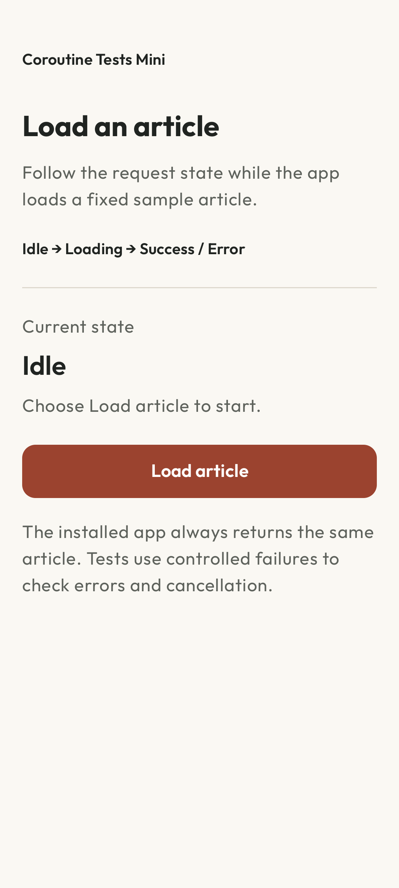

# Coroutines Tests Mini

[Español](README.es.md) · [CI](https://github.com/navalcode/android-coroutines-tests-mini/actions/workflows/checks.yml)

A small Android Views app and coroutine test suite. Load a fixed article, watch Idle → Loading → Success and try loading it again. The button stays disabled while the request runs; activity recreation retains the ViewModel result.



## Try it

1. Select **Load article**. The screen shows Loading immediately and disables the action.
2. Wait for the fixed article, then select **Load again**.
3. Recreate the activity to check that the ViewModel retains its result. A process restart starts a new ViewModel; the app does not persist the article.

The installed source always succeeds after a short delay. Errors and cancellation use controlled repositories in tests. The separate search ViewModel demonstrates replacing an obsolete query; this app has no search UI or network backend. The original article fixture is English in both interface languages.

## Build and run

Use JDK 17, Android SDK 36 and API 24+ for installation. Open the project in Android Studio or configure the SDK in an untracked `local.properties`. From this directory:

```sh
./gradlew :app:testDebugUnitTest :app:lintDebug :app:assembleDebug
./gradlew :app:installDebug
```

The Gradle 8.13 wrapper verifies its distribution SHA-256. Dependencies are pinned in `gradle/libs.versions.toml`. Native test locale rules require API 33+; replace `DEVICE_ID` with an explicit serial:

```sh
ANDROID_SERIAL=DEVICE_ID ./gradlew :app:connectedDebugAndroidTest
```

## Read the code

1. [ArticleUiState.kt](app/src/main/java/com/example/coroutinetests/presentation/ArticleUiState.kt) and [ArticleViewModel.kt](app/src/main/java/com/example/coroutinetests/presentation/ArticleViewModel.kt): state and request ownership.
2. [ArticleViewModelTest.kt](app/src/test/java/com/example/coroutinetests/presentation/ArticleViewModelTest.kt): Idle, Loading/Success, failure and cancellation.
3. [LoadArticleUseCaseTest.kt](app/src/test/java/com/example/coroutinetests/domain/LoadArticleUseCaseTest.kt) and [FakeArticleRepository.kt](app/src/test/java/com/example/coroutinetests/testdoubles/FakeArticleRepository.kt): results, failures and controlled delays.
4. [MainDispatcherRule.kt](app/src/test/java/com/example/coroutinetests/rules/MainDispatcherRule.kt): install/reset the test Main dispatcher.
5. [ArticleSearchViewModelTest.kt](app/src/test/java/com/example/coroutinetests/presentation/ArticleSearchViewModelTest.kt): `collectLatest` cancels a superseded search.

Tests advance scheduler time with `runCurrent` and `advanceUntilIdle`, without wall-clock sleeps. `ObserveSavedArticlesUseCaseTest` checks several Flow emissions. Cancellation remains cancellation rather than becoming an error state.

[Spanish testing notes](docs/TESTING.es.md) explain dispatcher injection, virtual time and the test cases.

## Checks and limits

The suite contains **9 JVM tests and 3 native tests**. [Verification](docs/VERIFICATION.md) records dated runs, screenshots, audit warnings and the difference between local native coverage and hosted CI. [DESIGN.md](DESIGN.md) explains the interface.

Spanish resources have an English fallback. No physical-device, formal accessibility, optimized-release or store result is claimed. Existing licenses and font/dependency attribution remain in [third-party notices](THIRD_PARTY.md).
